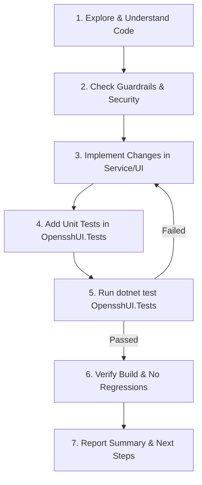

# AGENT.md - OpensshUI Development & Maintenance Guide

คู่มือมาตรฐานและแนวปฏิบัติที่ดีที่สุด (Best Practice & Operational Guide) สำหรับ AI Agent และนักพัฒนาในการบำรุงรักษา, พัฒนาต่อยอด และทดสอบระบบ **OpensshUI**

---

## 1. Executive Summary & Project Overview (ภาพรวมโครงการ)

**OpensshUI** เป็นเว็บแอปพลิเคชันที่พัฒนาด้วย **ASP.NET Core (.NET 8)** และ **Blazor Interactive Server** สำหรับบริหารจัดการ Windows OpenSSH SFTP Server บนระบบปฏิบัติการ Windows โดยเฉพาะ

### Core Responsibilities (ขอบเขตหน้าที่หลัก)
1. **User Management:** จัดการ Local Windows Users, การกำหนด Home Directory, Chroot Directory, Quota, และสถานะการเปิด/ปิดบัญชี
2. **SSH Key Management:** จัดการ Public Keys สำหรับ SFTP Authentication พร้อมตัวแปลงรูปแบบคีย์ (OpenSSH, RFC4716, PKCS#8/PEM, PuTTY `.ppk`)
3. **Group & Junction Management:** จัดการ SFTP Groups และสร้าง NTFS Directory Junctions สำหรับการแชร์โฟลเดอร์ระหว่างกลุ่มผู้ใช้ ป้องกัน Symlink Attack
4. **Strict Chroot NTFS ACL Provisioning (`INtfsAclService`):** กำหนดสิทธิ์โฟลเดอร์ระดับ OS อย่างเข้มงวดตามข้อกำหนดของ OpenSSH Chroot (Root ต้องมีเฉพาะ `SYSTEM` และ `Administrators` เท่านั้นที่มีสิทธิ์เขียน, ผู้ใช้ทั่วไปมีสิทธิ์เฉพาะโฟลเดอร์ย่อย) พร้อมระบบ Path Safety Validation ป้องกัน Path Traversal
5. **Atomic `sshd_config` Engine (`ISshdConfigService`):** จัดการไฟล์คอนฟิกแบบแยกส่วน (Global Directives และ Match Blocks) ป้องกันปัญหา Directive Bleeding, ตรวจสอบไวยากรณ์ด้วย `sshd.exe -t` ก่อนบันทึกจริง, เขียนไฟล์แบบ Atomic ป้องกันไฟล์เสียหาย และมีระบบ Rolling Backup สูงสุด 5 ชุด
6. **Dual Service Controller (`IOpenSshServiceManager`):** ควบคุมและตรวจสอบสถานะของ Windows Services ทั้ง `sshd` และ `ssh-agent` พร้อมเครื่องมือทดสอบไวยากรณ์ก่อน Restart และระบบโครงสร้าง Zero-Config Reload (`Match Group SFTP-Users`)
7. **Optimized Event Log Engine (`ISshEventLogService`):** ตรวจสอบบันทึกกิจกรรม OpenSSH จาก Windows Event Log (`OpenSSH/Operational`) ผ่าน Regex Parser ความเร็วสูง แยกสถานะ Authentication, User, IP, Port, และส่งออก CSV ได้
8. **Secure Web File Browser:** ระบบสำรวจไฟล์ผ่านเว็บอินเทอร์เฟซ โดยจำกัดขอบเขตภายใต้ SFTP Root อย่างเคร่งครัด
9. **Authentication & Audit:** รองรับ LDAP / Active Directory ร่วมกับ Fallback Local Admin และบันทึก Audit Logs ทุกกิจกรรมลง SQLite (WAL Mode)
10. **Web Admin & RBAC Management (`IWebAdminService`):** จัดการบัญชีผู้ดูแลหน้าเว็บแยกรายบุคคล (Local Admin พร้อมรหัสผ่าน PBKDF2 และเชื่อมโยงผู้ใช้ Active Directory ผ่าน Live Search), กำหนดบทบาทสิทธิ์ (`SuperAdmin`, `Operator`, `Auditor`), ระบบคุ้มกันความปลอดภัย (Self-Lockout Prevention, Last SuperAdmin Protection) และการบันทึก Audit Accountability รายคน
11. **Real-Time Live SFTP Session Management (`ISftpSessionService`):** ตรวจสอบเซสชันสดผ่าน Win32 TCP Table + Process Token API, ระบุชื่อผู้ใช้แบบ Canonical, ตรวจจับการเชื่อมต่อซ้ำซ้อน (> 5 sessions), สั่งเตะเซสชันรายตัวหรือรายยูสเซอร์พร้อม Safety Guard (sshd/sftp-server only) และเก็บบันทึก Audit Logs
12. **High-Concurrency Performance Tuning Engine (`ISshdConfigService`):** จัดการและปรับแต่งพารามิเตอร์ Concurrency (`MaxStartups`, `MaxSessions`, `ClientAliveInterval`, `ClientAliveCountMax`, `LoginGraceTime`) แบบ Presets ใน `GlobalLines` พร้อม `sshd -t` syntax check และ Atomic Write

---

## 2. Architecture & Design Principles (สถาปัตยกรรมและหลักการออกแบบ)

โปรเจกต์นี้ใช้รูปแบบ **Hybrid Monolith (Clean Service Layer)** เพื่อความคล่องตัว ดูแลรักษาง่าย และไม่มีความซับซ้อนเกินจำเป็นของ Microservices หรือ Multi-project ที่แยกย่อยเกินไป

```
OpensshUI (Root Project - net8.0-windows)
├── Components/             # Blazor Interactive Server UI
│   ├── Layout/             # MainLayout, NavMenu, Scoped CSS
│   ├── Pages/              # Page components
│   │   ├── Admin/          # WebAdminManagement (Web Admin Users & RBAC)
│   │   ├── Auth/           # Login
│   │   ├── Files/          # Secure File Browser
│   │   ├── Groups/         # Group Management
│   │   ├── Logs/           # OpenSshLogPage (Event Logs), WebAuditLogPage
│   │   ├── Service/        # ServiceControlPage (sshd & ssh-agent controller)
│   │   ├── Sessions/       # SessionManagement (SFTP Live Sessions & Disconnect)
│   │   ├── Settings/       # Settings, LDAP Config
│   │   └── Users/          # User Management, SshKeysModal
│   └── Shared/             # Reusable UI widgets & Modals (e.g. FolderPickerModal)
├── Data/                   # EF Core DbContext & Migrations
│   └── AppDbContext.cs     # SQLite DbContext with WAL mode & Custom Migrations
├── Models/                 # Domain Entities & View Models (POCOs)
│   ├── AuditLog.cs
│   ├── LdapConfig.cs
│   ├── OpenSshLogEntry.cs  # Windows Event Log Models & Query Results
│   ├── SftpGroup.cs
│   ├── SftpSessionInfo.cs  # Active SFTP Live Sessions & Metrics
│   ├── SftpUser.cs
│   ├── SshdConcurrencySettings.cs # Concurrency & Connection Limit Settings
│   ├── SshLogFilter.cs     # Time Presets & Filter Parameters
│   ├── SshPublicKey.cs
│   └── WebAdminUser.cs     # Web UI Admin Users, Account Types & Roles
├── Services/               # Core Business Logic & OS Integrations
│   ├── Audit/              # IAuditService, AuditService
│   ├── Auth/               # ILdapAuthService, LdapAuthService, IWebAdminService, WebAdminService, UserSessionState
│   ├── Files/              # ISecureFileBrowserService, SecureFileBrowserService
│   ├── Groups/             # ISftpGroupService, SftpGroupService
│   ├── OpenSsh/            # Core OpenSSH & OS Services
│   │   ├── INtfsAclService.cs / NtfsAclService.cs             # Strict Chroot NTFS ACL & Junctions
│   │   ├── ISshdConfigService.cs / SshdConfigService.cs       # Atomic sshd_config & syntax engine
│   │   ├── ISshEventLogService.cs / SshEventLogService.cs     # Windows Event Log query & export
│   │   ├── ISftpSessionService.cs / SftpSessionService.cs     # Real-time Win32 TCP & Live Session Orchestrator
│   │   ├── SshLogParser.cs                                    # High-speed Event Log Regex Parser
│   │   ├── IOpenSshServiceManager.cs / OpenSshServiceManager.cs # Service lifecycle (sshd & ssh-agent)
│   │   ├── IWindowsUserManager.cs / WindowsUserManager.cs     # Local account orchestration
│   │   ├── ISshKeyGenerator.cs / SshKeyGenerator.cs           # Key conversion & generation
│   │   └── NativeAclProvisioner.cs / OpenSshLogService.cs     # Compatibility wrappers
│   ├── Security/           # IProtectionService, ProtectionService, PasswordHasher
│   └── Users/              # ISftpUserService, SftpUserService
└── OpensshUI.Tests/        # Test Suite (xUnit, FluentAssertions, 298+ tests)
```

### Architectural Rules for Agents:
1. **Interface Segregation:** ทุก Service ในโฟลเดอร์ `Services/` ต้องมี Interface กำกับเสมอ (เช่น `ISshdConfigService`, `INtfsAclService`, `ISshEventLogService`) และลงทะเบียนใน DI Container ผ่าน `Program.cs`
2. **UI Decoupling:** ห้าม Razor Components เรียกใช้ OS APIs, `System.IO` (เช่น `File.WriteAllText`, `Path.GetFullPath`, `Path.GetInvalidFileNameChars`), Process Execution หรือ Entity Framework DbContext โดยตรง ต้องเรียกผ่าน Service Layer หรือ `SecurityValidator` เสมอ
3. **DbContext Concurrency in Blazor:** Blazor Server มี Long-lived connection ห้าม Inject `AppDbContext` เป็น Scoped โดยตรง แต่ต้องใช้ `IDbContextFactory<AppDbContext>` เพื่อหลีกเลี่ยง Concurrency Issue และ Thread Safety Conflicts
4. **Configuration Safety:** การแก้ไขหรือซิงค์ไฟล์ `sshd_config` **ต้องเรียกผ่าน `ISshdConfigService` หรือ `IOpenSshServiceManager` เสมอ** ห้ามเขียนทับไฟล์โดยตรงเด็ดขาด เพื่อให้ผ่านการตรวจสอบ `sshd -t` และมีการทำ Rolling Backup ทุกครั้ง
5. **Zero `eval()` & Stream-Based JS Interop:** ห้ามใช้ `IJSRuntime.InvokeVoidAsync("eval", ...)` หรือส่งข้อมูลไฟล์ผ่าน Base64 Data URI ในสตริง JavaScript เด็ดขาด เพราะเสี่ยงต่อ CSP/XSS และทำให้ SignalR Buffer หน่วง ต้องใช้ `DotNetStreamReference` ร่วมกับฟังก์ชัน `downloadFileFromStream` เสมอ
6. **Zero Dead Code & Stream Draining Discipline:**
   - **ห้ามทิ้งตัวแปรหรือฟังก์ชันที่ไม่ได้ใช้งาน:** ตัวแปรที่รับผลลัพธ์เพื่อ validate หรือตรวจ side effect ต้องใช้ Discard pattern (`_ = ...`) เสมอ และห้ามมีฟังก์ชันผี (Unreferenced private members) หรือ Unused `using` statements (`IDE0005`) ค้างในโค้ด
   - **Process Stream Draining:** เมื่อมีการรัน External Process (`Process.Start`) และเปิด Redirect Standard Streams ต้อง Drain/Await ทั้ง `StandardOutput` และ `StandardError` ให้ครบถ้วนเสมอ (`_ = await stdoutTask; var err = await stderrTask;`) เพื่อป้องกัน OS Process Buffer Deadlock
   - **UI Dependency Cleanliness:** ห้ามใส่ `@inject` Service ใน Razor Component หากไม่มีการเรียกใช้งานจริงในคอมโพเนนต์นั้น เพื่อลด Circuit Allocation Overhead ใน Blazor Server
   - **Service Contract Completeness:** เมธอดสาธารณะทุกตัวใน Interface และ Service Layer ต้องมี Caller จริง หรือมี Unit Test ครอบคลุมครบถ้วนตามหลัก Clean Architecture (ห้ามทิ้ง Orphan Service APIs ไว้โดยไร้การทดสอบ)

### UI/UX & Blazor Component Standards:
1. **Unified Visual Hierarchy:**
   - ทุกหน้าใน `Components/Pages/` ต้องเริ่มต้นด้วย `.page-header` (ซ้าย: `<h3 class="page-title">` พร้อมไอคอนและคำอธิบายย่อย / ขวา: ปุ่ม Refresh และ Primary Action)
   - ถัดจาก Header เป็น Alert Banner -> Search & Filter Bar -> Data Card / Table
2. **Strict Icon-Text Alignment & Zero Redundant Emojis:**
   - ใช้ Bootstrap Icons (`<i class="bi ..."></i>`) เท่านั้น **ห้ามใช้ Emoji หรืออักขระพิเศษที่ซ้ำซ้อนกับ Icon**
   - ไอคอนทุกจุดต้องอยู่ในระดับกึ่งกลางแนวตั้งเดียวกับตัวหนังสือ (`display: inline-flex; align-items: center; line-height: 1;`)
3. **Ergonomic Admin Action Buttons:**
   - ในคอลัมน์ Actions ของตาราง ให้ใช้ `.action-bar` โดยมีข้อความกำกับคู่กับไอคอน และคั่นปุ่มอันตราย (`ลบ`, `Stop Service`) ออกไปทางขวาสุดด้วย `<span class="action-divider"></span>`
4. **Guided Form & Indirect Workflow Standards:**
   - ฟอร์มและ Modal ที่ซับซ้อนต้องแบ่งลำดับสายตาเป็นขั้นตอนด้วย `.form-step-header` และ `.form-step-badge` (`1` → `2` → `3`) และซ่อนการตั้งค่าขั้นสูงที่ไม่ได้ใช้บ่อยไว้หลังสวิตช์เปิด/ปิด (Progressive Disclosure)
   - ใช้ `.selection-card` แทน Radio/Select เมื่อต้องตัดสินใจเชิงโครงสร้าง, ใช้ `.auto-fill-chip` สำหรับปุ่มลัดเติมค่ามาตรฐาน และแสดงผลลัพธ์ปลายทางใน `.effective-preview-box` ก่อนกดยืนยัน
   - ข้อความแจ้งเตือนข้อผิดพลาดของฟอร์มต้องแสดงภายใน Modal เสมอ และปุ่ม Primary CTA ต้องบังคับทางอ้อม (Indirect Workflow) โดย Disable จนกว่าฟิลด์บังคับ (`*`) และการยืนยันรหัสผ่านจะถูกต้องครบถ้วน

---

## 3. Security & OS Guardrails (ข้อกำหนดด้านความปลอดภัยขั้นสูง)

> [!CAUTION]
> โปรเจกต์นี้มีโค้ดที่สั่งการระบบปฏิบัติการ Windows (สร้าง User จริง, รัน net.exe, จัดการ ACLs, ควบคุม Service) การผิดพลาดอาจส่งผลกระทบต่อความมั่นคงปลอดภัยของเครื่อง Host

AI Agent **ต้องปฏิบัติตามกฎเหล็กเหล่านี้อย่างเคร่งครัด**:

### 3.1 Strict Process & Shell Execution Guardrails
- **ห้ามสร้าง Raw Shell Execution:** หลีกเลี่ยงการประกอบ String Command เช่น `cmd.exe /c "..."` หรือ `powershell -c "..."` ที่เสี่ยงต่อ Command Injection
- **ใช้ ProcessStartInfo แบบ Parameterized เท่านั้น:** ส่ง Arguments ผ่าน `ArgumentList` (เช่น `psi.ArgumentList.Add(...)`) แทนการต่อ String
- **Input Sanitization:** ตรวจสอบ Username, GroupName และ Path อย่างเข้มงวด ห้ามมีอักขระพิเศษที่เป็นอันตราย เช่น `;`, `&`, `|`, `` ` ``, `$`, `>`, `<`

### 3.2 Strict OpenSSH Chroot & NTFS ACL Rules
- **Chroot Root Directory Ownership:** ตามข้อกำหนดของ OpenSSH Chroot ไดเรกทอรีที่เป็น Chroot Root (เช่น `D:\SFTPRoot\<user>`) ต้องมีเจ้าของเป็น Administrators/SYSTEM เท่านั้น และ**ห้ามมิให้ผู้ใช้หรือกลุ่มผู้ใช้ทั่วไปมีสิทธิ์ Write เด็ดขาด** หากผิดข้อกำหนด OpenSSH จะปฏิเสธการเชื่อมต่อทันที
- **User Subdirectories Only:** ผู้ใช้จะได้รับสิทธิ์ Modify เฉพาะโฟลเดอร์ย่อยที่อยู่ภายใต้ Chroot Root เท่านั้น (เช่น `D:\SFTPRoot\<user>\data` หรือ Junctions)
- **Path Traversal Defense:** ทุก Path ต้องผ่าน `INtfsAclService.ValidatePathSafety` และ `Path.GetFullPath` เพื่อป้องกัน Traversal ออกนอกพื้นที่ที่ได้รับอนุญาต

### 3.3 Atomic `sshd_config` Modification & Rolling Backup
- **Syntax Pre-flight Check:** ทุกครั้งที่มีการบันทึกหรืออัปเดตเนื้อหา `sshd_config` จะต้องผ่านการตรวจไวยากรณ์ด้วย `sshd.exe -t` ก่อนเสมอ
- **Atomic Replace:** บันทึกข้อมูลลง Temp File ก่อน จากนั้นสลับไฟล์ด้วย `File.Replace` หรือ Atomic Move เพื่อป้องกันไฟล์คอนฟิกเสียหายกรณีเครื่องดับ
- **Rolling Backup:** ระบบเก็บไฟล์สำรอง `.bak` สูงสุด 5 ชุดตามลำดับเวลา

### 3.4 Sensitive Data & Secrets Protection
- **No Plaintext Passwords:** ห้ามเก็บรหัสผ่านเป็น Plaintext ใน SQLite หรือ Log
- **ASP.NET DataProtection:** รหัสผ่าน LDAP Bind Password หรือ Credentials ใดๆ ต้องเข้ารหัสผ่าน `IProtectionService` (DataProtection API)
- **Local Fallback Admin:** ใช้ Secure Hash (PBKDF2 with Salt) ตามคลาส `PasswordHasher`

### 3.5 Web Admin & RBAC Security Guardrails
- **Self-Lockout Prevention:** ระบบต้องไม่อนุญาตให้ผู้ดูแลระบบที่กำลังล็อกอินอยู่ ลบหรือระงับการใช้งาน (`IsActive = false`) บัญชีของตนเอง
- **Last SuperAdmin Preservation:** ระบบต้องไม่อนุญาตให้ลดระดับสิทธิ์, ระงับ หรือลบ Super Admin บัญชีสุดท้ายของระบบ เพื่อป้องกันการล็อกระบบโดยสมบูรณ์
- **Fallback Disaster Recovery Protection:** บัญชี Local Admin ฉุกเฉินหลัก (`admin`) จะไม่สามารถถูกลบออกจากระบบได้ แต่สามารถเปลี่ยนรหัสผ่านหรือระงับการใช้งานได้
- **Password Security:** รหัสผ่าน Local Web Admin ต้องมีความยาวขั้นต่ำ 8 ตัวอักษร และเข้ารหัสด้วย PBKDF2 SHA-256 พร้อม Salt ผ่าน `PasswordHasher` เสมอ
- **Strict Role-Based Access Control:**
  - `SuperAdmin`: เข้าถึงได้ทุกฟังก์ชัน (จัดการระบบ, จัดการ Web Admins, ตั้งค่า LDAP, ควบคุม sshd)
  - `Operator`: จัดการได้เฉพาะ SFTP Users, SFTP Groups และ File Browser (ไม่สามารถแก้ไขระบบหรือจัดการ Web Admin ได้)
  - `Auditor`: สิทธิ์อ่านอย่างเดียว (Read-Only) สำหรับผู้ตรวจสอบ (ดู Dashboard, OpenSSH Logs, Audit Logs)
- **Dual-Layer RBAC Enforcement (UI + Code-Behind Guard Clauses):** ทุกหน้าใน `Components/Pages/` ต้องบังคับใช้สิทธิ์จาก `UserSessionState` ทั้ง **2 ระดับเสมอ**:
  1. **Layer 1 (UI Markup):** ซ่อนหรือปิดปุ่ม Action ที่เกินสิทธิ์ของผู้ใช้ที่กำลังล็อกอินอยู่
  2. **Layer 2 (`@code` Event Handler Guard):** ทุกเมธอดที่ทำการเปลี่ยนแปลงข้อมูลหรือสั่งการระบบ (Mutating Methods) ต้องมี Guard Clause ตรวจสอบสิทธิ์ที่บรรทัดแรกเสมอ:
     - `SessionState.CanManageSystem` (`SuperAdmin` เท่านั้น): บังคับใช้ใน `/web-admins` (`WebAdminManagement.razor`), `/settings` (`SettingsPage.razor`), การสั่งควบคุมบริการใน `/service` (`ServiceControlPage.razor`), และปุ่มติดตั้ง Zero-Config ใน `/` (`Home.razor`)
     - `SessionState.CanManageSftp` (`SuperAdmin` และ `Operator`): บังคับใช้ในทุกฟังก์ชันสร้าง/แก้ไข/ลบ/เปลี่ยนรหัสผ่าน/จัดการคีย์/อัปโหลดไฟล์ใน `/users` (`UserManagement.razor`), `/groups` (`GroupManagement.razor`), และ `/files` (`FileExplorerPage.razor`)

### 3.6 Performance, Concurrency & Resource Guardrails (ข้อกำหนดด้านประสิทธิภาพและการทำงานร่วมกัน)
1. **Zero-Config Reload Discipline:** ห้ามเรียก `SyncAllDirectChrootConfigsAsync()` หรือสั่ง Restart `sshd` Service เมื่อสร้างหรือแก้ไขผู้ใช้/กลุ่มที่อยู่ในโหมด `VirtualFolder` ต้องเรียกเฉพาะเมื่อมีการใช้งานหรือเปลี่ยนแปลงโหมด `DirectChroot` เท่านั้น
2. **Full-Cycle Concurrency Locking:** การทำ Read-Modify-Write บนไฟล์สำคัญของระบบ (`sshd_config` และไฟล์ `AuthorizedKeys`) ใน Singleton Services ต้องถือ Lock (`SemaphoreSlim`) ครอบคลุมตั้งแต่ขั้นตอน Read -> Parse -> Modify -> Validate -> Atomic Replace ทั้งกระบวนการ เพื่อป้องกัน Race Condition (TOCTOU / Lost Update)
3. **Idempotent OS Provisioning & SID Caching:**
   - การสร้าง NTFS Directory Junction (`CreateDirectoryJunction`) ต้องตรวจสอบด้วย `ResolveLinkTarget` ก่อนว่าลิงก์เดิมชี้ไปยังปลายทางที่ถูกต้องอยู่แล้วหรือไม่ หากตรงกันอยู่แล้วให้คืนค่า `true` ทันทีโดยไม่ลบและไม่แตกโปรเซส `cmd.exe /c mklink /J` ซ้ำ
   - ใช้ Thread-safe SID Cache สำหรับการแปลง `NTAccount` เพื่อลดการเรียก Windows LSASS RPC ซ้ำซ้อน
4. **Bounded In-Memory State:** โครงสร้างข้อมูลแบบ Static หรือ Singleton ในหน่วยความจำ (เช่น `LoginAttempts` สำหรับป้องกัน Brute-force หรือ `AccountStateOverrides` ใน `UserSessionState`) ต้องมีเพดานขนาดสูงสุด (Bounded Capacity <= 1,000) และมีกลไก Pruning ล้างข้อมูลที่หมดอายุออกเสมอเพื่อป้องกัน Memory Leak
5. **Native Event Log XPath Filtering & Compiled Regex:** การดึง Windows Event Log ต้องสร้าง XPath Time Filter (`@SystemTime`) ส่งให้ระดับ OS คัดกรองก่อนเสมอ และทุก Regex ที่ถูกเรียกซ้ำในลูป (รวมถึง `SecurityValidator.SanitizeSingleLine`) ต้องใช้ `RegexOptions.Compiled`

### 3.7 Inviolable Security Commandments (8 กฎเหล็กห้ามละเมิดเด็ดขาด)
> [!CAUTION]
> กฎเหล็ก 8 ข้อนี้ถือเป็น "Absolute Security Baseline" ของระบบ OpensshUI ห้าม AI Agent หรือผู้พัฒนาแก้ไข ดัดแปลง หรือยกเว้นโดยเด็ดขาด การละเมิดข้อใดข้อหนึ่งจะถูกจับได้โดยชุดทดสอบ Governance & Evil User Suite ทันที:

1. **[C1] Canonical Username Everywhere:** ทุกจุดที่มีการค้นหาฐานข้อมูล (`WebAdminUsers`), เช็คสิทธิ์ RBAC, ตรวจสอบ Self-Lockout, หรือนับโควตา Brute-Force Lockout **ต้องผ่าน `SecurityValidator.ExtractCanonicalUsername` เสมอ** เพื่อป้องกันการหลบเลี่ยงด้วยรูปแบบ `DOMAIN\user` หรือ `user@domain`
2. **[C2] Full-Spectrum Safe Custom Path:** พาธใดๆ ที่รับจากภายนอกหรือผู้ใช้ (เช่น `CustomRootPath`, `RootPath`) **ต้องผ่าน `SecurityValidator.ValidateSafeCustomPath(path, sftpRoot)` เสมอ** ซึ่งจะปฏิเสธ UNC (`\\`), 8.3 Short Names (`~`), NTFS ADS (`:`), DOS device names (`CON`, `PRN`, ฯลฯ), โฟลเดอร์ `.ssh`, โฟลเดอร์โปรไฟล์ `C:\Users`, ราก `C:\ProgramData`, และการชี้ทับราก `SftpRoot`
3. **[C3] RFC 4251 Wire-Format Verification:** การนำเข้าคีย์สาธารณะ OpenSSH หรือ PuTTY **ต้องถอดรหัสไบนารีด้านใน Base64 และตรวจหัวข้อ RFC 4251 string เสมอ** ว่าชนิดคีย์ตรงกับ Header ที่อ้างสิทธิ์ ห้ามเชื่อถือเพียงสตริงนำหน้า และต้องปฏิเสธคีย์ที่มีความยาวสั้นผิดปกติ (< 16 ไบต์) หรือยาวเกิน 16 KB
4. **[C4] DirectChroot Preservation:** ห้ามลบหรืออนุญาตให้ผู้ใช้/แอดมินลบโฟลเดอร์ย่อย `files` ภายใต้รากของโหมด `DirectChroot` ผ่าน Web File Browser และห้าม `SecureFileBrowserService` สร้างโฟลเดอร์ราก `DirectChroot` ขึ้นใหม่ด้วยสิทธิ์ Inherited ปกติ (เพราะจะทำให้ OpenSSH Chroot ปฏิเสธการล็อกอินเนื่องจากผิดกฎ Strict Ownership)
5. **[C5] Atomic sshd_config Pipeline:** ห้ามเขียนทับไฟล์ `sshd_config` ตรงๆ เด็ดขาด ต้องผ่าน `ISshdConfigService.AtomicWriteAndApplyAsync` หรือ `SyncManagedBlocksAsync` ที่มีขั้นตอน Pre-flight syntax check (`sshd.exe -t`), Atomic Replace ผ่านไฟล์ชั่วคราวบนไดรฟ์เดียวกัน และ Rolling Backup สูงสุด 5 ชุด
6. **[C6] Junction Detach Safety Before Recursive Delete:** ก่อนที่ `SftpUserService.DeleteUserAsync` จะสั่งลบโฟลเดอร์ผู้ใช้แบบ Recursive (`Directory.Delete(userDir, true)`) ต้องยืนยันว่า `RemoveDirectoryJunction` ถอดสำเร็จทุกจุด หากมีจุดใดล้มเหลวและโฟลเดอร์ยังคงอยู่ **ต้องยกเลิกการลบโฟลเดอร์ทันที** เพื่อไม่ให้ข้อมูลในโฟลเดอร์แชร์ของกลุ่มถูกลบไปด้วย
7. **[C7] Bounded In-Memory State & Auto-Pruning:** Static Collection ทุกตัวในระบบที่เก็บข้อมูลจากผู้ใช้ (เช่น `LoginAttempts` ใน `LdapAuthService` และ `AccountStateOverrides` ใน `UserSessionState`) ต้องจำกัดขนาดสูงสุดไม่เกิน 1,000 รายการ และมีกลไก Eviction/Pruning ข้อมูลเก่าอัตโนมัติ
8. **[C8] Least Privilege AD Fallback Guard:** เมื่อเกิด Fallback AD Authentication หากผู้ใช้ไม่อยู่ในตาราง `WebAdminUsers` และไม่ได้กำหนดค่า `AdminGroup` ในระบบ **ต้องปฏิเสธการล็อกอินทันที** ห้ามมอบสิทธิ์ `SuperAdmin` ให้อัตโนมัติเด็ดขาด

### 3.8 Anti-Regression Matrix (ตารางข้อพึงระวัง ป้องกันการแก้โค้ดย้อนกลับไปย้อนมา)
> ตารางนี้เปรียบเทียบโค้ดที่ไม่ปลอดภัย (DON'T) กับโค้ดมาตรฐานที่ถูกต้อง (DO) เพื่อป้องกันไม่ให้ AI หรือผู้พัฒนาเผลอนำโค้ดรูปแบบเดิมกลับมาใช้:

| หมวดหมู่ความปลอดภัย | ❌ DON'T (ห้ามเขียนแบบนี้เด็ดขาด) | ✅ DO (ต้องเขียนแบบนี้เสมอ) |
|---|---|---|
| **การค้นหาชื่อผู้ใช้ AD/Admin** | `db.WebAdminUsers.FirstOrDefault(u => u.Username.ToLower() == username.ToLower())` | `var canon = SecurityValidator.ExtractCanonicalUsername(username);`<br/>`db.WebAdminUsers.FirstOrDefault(u => u.Username.ToLower() == clean.ToLower() \|\| u.Username.ToLower() == canon.ToLower())` |
| **การตรวจสอบ Path โฟลเดอร์** | `var full = Path.GetFullPath(path); Directory.CreateDirectory(full);` | `var (ok, err) = SecurityValidator.ValidateSafeCustomPath(path, sftpRoot);`<br/>`if (!ok) return (false, err);` |
| **การตรวจคีย์สาธารณะ OpenSSH** | `var parts = line.Split(' '); if (Allowed.Contains(parts[0])) return true;` | `var res = SshKeyConverter.ParseAndNormalizeKey(line);`<br/>*(ระบบจะแกะตรวจ RFC 4251 Wire-Format Header ด้านใน Base64)* |
| **การลบไฟล์/โฟลเดอร์ในเว็บ** | `Directory.Delete(targetPath, true);` | `if (isDirectChroot && target.Equals(filesDir)) throw new InvalidOperationException("Cannot delete protected 'files' folder.");` |
| **การถอด Junction ก่อนลบ User** | `foreach (var j in junctions) RemoveJunction(j); Directory.Delete(userDir, true);` | `bool ok = RemoveJunction(j); if (!ok && Directory.Exists(j)) { abortRecursiveDelete = true; }` |
| **การสร้างบล็อก `Match` ใน config** | `sb.AppendLine($"Match User {rule.Identifier}");` | กรองอักขระ `*`, `?`, `!`, `,` และช่องว่างออกจาก `rule.Identifier` ก่อนเสมอ |
| **การรับพารามิเตอร์ Comment** | `key.Comment = comment ?? parsed.Comment;` | `key.Comment = SecurityValidator.SanitizeSingleLine(comment) ?? parsed.Comment;` |
| **ตัวแปร Validation ที่ไม่ได้นำไปใช้ต่อ** | `var sid = acc.Translate(typeof(SecurityIdentifier));`<br/>*(ประกาศตัวแปรแล้วปล่อยทิ้งให้เกิด Warning CS0168/CS0219/IDE0059)* | `_ = acc.Translate(typeof(SecurityIdentifier));`<br/>*(ใช้ Discard Pattern `_` สื่อเจตนาชัดเจนและไม่เสีย Memory Allocation)* |
| **การอ่าน Process Streams** | `var stdoutTask = proc.StandardOutput.ReadToEndAsync();`<br/>`var stderrTask = proc.StandardError.ReadToEndAsync();`<br/>`var err = await stderrTask;`<br/>*(ไม่ await stdout)* | `var stdoutTask = proc.StandardOutput.ReadToEndAsync();`<br/>`var stderrTask = proc.StandardError.ReadToEndAsync();`<br/>`_ = await stdoutTask;`<br/>`var err = await stderrTask;`<br/>*(Drain ทั้งสอง Streams ป้องกัน OS Buffer Deadlock)* |
| **การฉีด Dependency ใน Razor** | `@inject NavigationManager Navigation`<br/>*(ใส่ไว้แต่ในโค้ดไม่มีการเรียกใช้)* | ฉีดเฉพาะ Service ที่เรียกใช้จริงในหน้านั้นเท่านั้น หากไม่ได้ใช้ให้ลบออกทันทีเพื่อลด Circuit Overhead |
| **Unused Using Statements** | ค้าง `using` ที่ไม่ได้ใช้งานไว้ในหัวไฟล์ | ลบออกเสมอ และเปิด `EnforceCodeStyleInBuild` ร่วมกับ `GenerateDocumentationFile` เพื่อให้ Roslyn จับ `IDE0005` |

---

## 4. Testing & Verification Standards (มาตรฐานการทดสอบ)

### 4.1 Tooling & Coverage
- **Test Framework:** `xUnit`
- **Assertions:** `FluentAssertions`
- **Security Hardening Suite:** `ProductionHardeningAndSecurityTests.cs`, `PerformanceAndResilienceTests.cs` และ `WebAdminServiceTests.cs` (ครอบคลุมความปลอดภัย ประสิทธิภาพ และการทำงานระดับ Production):
  1. **Domain 1:** `sshd_config` Parser, Hierarchy (Global vs Match blocks), Directive Bleeding Prevention, Atomic Write, Syntax Checking, และ Rolling Backup
  2. **Domain 2:** NTFS ACL Provisioning, OpenSSH Strict Chroot Permissions, Path Traversal Defense, และ Directory Junctions
  3. **Domain 3:** Windows Event Log Regex Parsing (`OpenSSH/Operational`), Event Type Identification, Authentication Status, และ CSV Export
  4. **Domain 4:** Dual Service Controller (`sshd` และ `ssh-agent`) Lifecycle & Fallback Behavior
  5. **Domain 5:** Web Admin User Management, PBKDF2 Hashing, Active Directory Live Search, Role RBAC, และ Self-Lockout Guardrails
  6. **Domain 6:** Performance, Concurrency & Dual-Layer RBAC Contract Suite (Zero-Reload Discipline, Full-Cycle Locking, Idempotent Junctions, Bounded Memory, Zero `eval()` Interop, และ UI/Handler RBAC Guards)

### 4.2 Rules for Testing
1. **Mock OS Dependencies:** ในการทดสอบ Unit Tests ห้ามเรียก `net.exe`, ห้ามสร้าง Windows User จริง, และห้ามสั่งปิด Windows Service บนเครื่องทดสอบจริง
2. **Mandatory Test Execution:** ก่อนสรุปงานทุกครั้ง Agent ต้องรันชุดทดสอบและยืนยันว่าผลผ่าน 100%:
   ```powershell
   dotnet test OpensshUI.Tests\OpensshUI.Tests.csproj
   ```
3. **No Regressions & Security Coverage:** ชุดทดสอบทั้งหมด (298+ tests รวมถึง `EvilUserSecurityTests.cs` และ `GovernanceAndArchitectureTests.cs`) ต้องผ่านครบถ้วน (`Failed: 0`)

### 4.3 Security & Anti-Regression Quality Gate
ทุกครั้งที่มีการแก้ไข Service หรือ Logic ด้านความปลอดภัย ชุดทดสอบกลุ่ม Security ทั้ง 3 ตัวนี้ต้องถูกเรียกตรวจเสมอ:
- `EvilUserSecurityTests.cs`: ทดสอบการโจมตีเชิงพฤติกรรม (Canonical AD bypass, Wire-format key spoofing, DirectChroot subfolder deletion, DOS devices, 8.3 short names, ADS)
- `ProductionHardeningAndSecurityTests.cs`: ทดสอบ `sshd_config` parser hierarchy, atomic replace, rolling backups, และ event log regex
- `GovernanceAndArchitectureTests.cs`: ตรวจสอบความสมบูรณ์ของกฎเกณฑ์ในโค้ดและเอกสารแบบอัตโนมัติ (รวมถึงการบังคับใช้ `.editorconfig` และ Roslyn Analyzers)

---

## 5. Development Workflow & Commands (คำสั่งและแนวทางการทำงาน)

### Build & Run
```powershell
# Restore & Build Project
dotnet build OpensshUI.csproj

# Build with Roslyn Analyzers & Code Style Verification (Zero Dead Code)
dotnet build OpensshUI.csproj --no-restore /p:EnforceCodeStyleInBuild=true

# Run Automated Tests (298+ Tests, 100% Pass)
dotnet test OpensshUI.Tests\OpensshUI.Tests.csproj

# Run Web Application (Development)
dotnet run --project OpensshUI.csproj

# Publish for Production
dotnet publish OpensshUI.csproj -c Release -o ./publish
```

---

## 6. Technical Debt & Improvement Roadmap (รายการปรับปรุงและ Roadmap)

### Priority 1: High (ความปลอดภัยและความพร้อมในการทดสอบ) [COMPLETED]
- [x] **Introduce Interfaces for OS Managers:** `IWindowsUserManager`, `INativeAclProvisioner`, `INtfsAclService`, `ISshdConfigService`, `ISshEventLogService`, `IOpenSshServiceManager`
- [x] **Refactor Process Execution to `ArgumentList`:** ป้องกัน Argument Injection โดยสมบูรณ์ในทุก Service
- [x] **Atomic `sshd_config` Engine:** แยกส่วน Global vs Match block, ตรวจสอบไวยากรณ์ด้วย `sshd.exe -t`, Rolling Backup 5 ชุด
- [x] **Strict Chroot NTFS ACL Engine:** ระบบกำหนดสิทธิ์ตามมาตรฐานความปลอดภัย OpenSSH Chroot และป้องกัน Path Traversal
- [x] **Dual Service Management:** รองรับการควบคุมทั้ง `sshd` และ `ssh-agent` พร้อมตรวจสอบไวยากรณ์ก่อนเริ่มงาน
- [x] **High-Performance Event Log Parser:** Optimized Regex Parser สำหรับ Windows Event Log (`OpenSSH/Operational`)
- [x] **Web Admin Management & Role-Based Access Control (RBAC):** บริหารจัดการบัญชีผู้ดูแลหน้าเว็บแยกรายบุคคล (Local Admin พร้อมรหัสผ่าน PBKDF2 และ Active Directory Live Search), สิทธิ์ 3 ระดับ (`SuperAdmin`, `Operator`, `Auditor`), ระบบ Guardrails ป้องกันการล็อกตัวเอง, และการระบุตัวตนใน Audit Logs
- [x] **Production Security Test Suite:** 210+ Unit & Integration Tests ครอบคลุมความปลอดภัยรอบด้าน (100% Pass)

### Priority 2: Medium (โครงสร้างและการจัดการข้อผิดพลาด)
- [ ] **Project Layout Normalization:** ปรับโครงสร้างแยก `src/OpensshUI` และ `tests/OpensshUI.Tests` ตามมาตรฐานโซลูชัน .NET เมื่อถึงรอบ Major Refactor
- [ ] **Unified Result Pattern:** นำ `Result<T>` หรือ `OperationResult` มาใช้แทนการ Return `bool` ในบางจุดของ Service Layer เพื่อส่งต่อข้อความแจ้งเตือนที่ละเอียดยิ่งขึ้น

### Priority 3: Low (ฟีเจอร์และการปรับปรุงทั่วไป)
- [ ] **EF Core Migrations:** ขยายจาก Custom Migrations สู่ EF Core Code-First Migrations
- [ ] **Comprehensive bUnit Testing:** ทดสอบ Blazor Component Rendering และ Event Handling ในเชิง UI อัตโนมัติ

---

## 7. AI Agent Execution Playbook (คู่มือการทำงานทีละขั้นตอนสำหรับ AI)



1. **สำรวจโค้ด (Explore):** อ่านไฟล์ที่เกี่ยวข้อง ตรวจสอบการพึ่งพา (Dependencies) ใน `Program.cs`
2. **ตรวจสอบความปลอดภัย (Security Check):** ตรวจสอบว่าไม่มี Hardcoded Secret, มีการ Sanitize Input, และใช้ Parameterized Arguments
3. **เขียนโค้ด (Implement):** พัฒนาตามหลัก Clean Service Layer และ Hybrid Monolith
4. **เขียนและรันชุดทดสอบ (Test):** เขียน Unit Test ครอบคลุม Business Logic ใหม่ และรัน `dotnet test OpensshUI.Tests\OpensshUI.Tests.csproj`
5. **ตรวจสอบความเรียบร้อย (Verify):** ยืนยันว่าโค้ดคอมไพล์ผ่าน ไม่เกิด Warning สำคัญ และเทสผ่านครบ 100%

### 7.1 Pre-Commit Quality & Security Gate (Checklist 7 ข้อยืนยันก่อนจบงาน)
ก่อนที่ AI Agent หรือผู้พัฒนาจะสรุปผลงานเสร็จสิ้น ต้องตรวจสอบตนเองผ่าน Checklist 7 ข้อนี้เสมอ:
- [ ] **[Check 1] Canonical AD User Check:** มีการใช้ `SecurityValidator.ExtractCanonicalUsername` ในจุดค้นหา/พิสูจน์ตัวตนหรือไม่?
- [ ] **[Check 2] Safe Custom Path Guard:** พาธโฟลเดอร์ใดๆ ผ่าน `SecurityValidator.ValidateSafeCustomPath(path, sftpRoot)` ครบถ้วนหรือไม่?
- [ ] **[Check 3] UI Decoupling Kept:** Component หน้าเว็บไม่มีการเรียกใช้ `File.*`, `Directory.*`, `Process.*` โดยตรงใช่หรือไม่?
- [ ] **[Check 4] Dual-Layer RBAC Enforced:** Event handler ทุกตัวที่มีการแก้ข้อมูล มี Guard Clause ตรวจสิทธิ์บรรทัดแรกหรือไม่?
- [ ] **[Check 5] Zero Dead Code & Ghost Injections:** ไม่มีตัวแปรไม่ได้ใช้ (`CS0168`, `CS0219`, `IDE0059`), ไม่มีฟังก์ชันผี (`IDE0051`), ไม่มี Unused Using (`IDE0005`), Drain ครบทุก Process Streams และไม่มี `@inject` ค้างใน Razor ใช่หรือไม่?
- [ ] **[Check 6] 100% Service Contract Test Coverage:** เมธอดทุกตัวใน Service Interfaces มี Caller จาก UI หรือมี Unit Test ครอบคลุมครบถ้วน (ไม่มี Orphan Service APIs ที่ไร้การทดสอบ) ใช่หรือไม่?
- [ ] **[Check 7] Test Suite 100% Pass:** รัน `dotnet test OpensshUI.Tests\OpensshUI.Tests.csproj` และผลผ่านทั้งหมด (298+ tests, Failed: 0) ใช่หรือไม่?

---

## 8. OWASP Top 10 (2021) Security Standards & Guardrails (มาตรฐานความปลอดภัยระดับองค์กร)

ระบบ OpensshUI ยึดมั่นตามมาตรฐานความปลอดภัยสารสนเทศ **OWASP Top 10 (2021)** โดยกำหนดข้อบังคับและ Guardrails สำหรับนักพัฒนาและ AI Agent ดังนี้:

### A01: Broken Access Control & Least Privilege
- **Least Privilege by Default:** บัญชีที่ยังไม่ได้เข้าสู่ระบบหรือหลังจากออกจากระบบ (`Logout()`) ใน `UserSessionState` ต้องมีบทบาทเป็น `WebAdminRole.Auditor` เสมอ (ห้ามตั้ง `SuperAdmin` เป็นค่าเริ่มต้นเด็ดขาด) และหากไม่ได้กำหนด `AdminGroup` ใน `LdapConfig` จะไม่อนุญาตให้ผู้ใช้ AD ที่ไม่อยู่ใน `WebAdminUsers` ล็อกอินแบบ Fallback ได้รับสิทธิ์ `SuperAdmin`
- **Canonical AD Username Normalization:** ต้องสกัดชื่อบัญชีมาตรฐานด้วย `SecurityValidator.ExtractCanonicalUsername` (ตัด `DOMAIN\` และ `@domain`) ทั้งใน `LdapAuthService` และ `WebAdminService` เพื่อป้องกันการสลับรูปแบบชื่อเพื่อหลบเลี่ยง RBAC, Self-Lockout หรือ Brute-Force Lockout
- **Role Propagation:** การล็อกอินผ่านหน้าเว็บทุกกรณี (`LoginModal.razor` และ `MainLayout.razor`) ต้องส่งค่า `result.Role` เข้าสู่ `SessionState.SetUser(..., result.Role)` อย่างชัดเจน เพื่อป้องกัน Privilege Escalation
- **Handler-Level RBAC Guards:** Razor Component ทุกตัวที่มีฟังก์ชันดำเนินการระดับผู้ดูแลระบบ (เช่น `WebAdminManagement.razor`, `FolderPickerModal.razor`) ต้องมี Guard Clause ตรวจสอบสิทธิ์ที่ระดับ C# Method เสมอ (เช่น `if (!SessionState.CanManageSystem) return;` หรือ `if (!SessionState.CanManageSftp) return;`) เพื่อป้องกันการส่ง Event ตรงผ่าน SignalR Connection
- **DirectChroot & CustomPath Integrity:** `SecurityValidator.ValidateSafeCustomPath` ต้องบล็อกพาธย่อ 8.3 (`~`), NTFS ADS (`:`), ชื่อสงวน DOS, โฟลเดอร์ `.ssh`, `C:\Users`, และห้ามตั้งทับราก `SftpRoot` รวมถึงห้าม `SecureFileBrowserService` ลบโฟลเดอร์ย่อย `files` ภายใต้ราก `DirectChroot` และต้องตรวจสอบผลลัพธ์ `RemoveDirectoryJunction` ก่อนสั่งลบโฟลเดอร์ผู้ใช้แบบ Recursive เสมอ

### A02: Cryptographic Failures & Algorithm Restrictions
- **Disallow Weak SSH Algorithms (`ssh-dss`) & Wire-Format Verification:** ห้ามเปิดใช้งานหรืออนุญาตคีย์ประเภท `ssh-dss` (DSA 1024-bit) โดยเด็ดขาดทั้งใน OpenSSH format และ RFC 4716 (PuTTY) format เนื่องจากอัลกอริทึม DSA อ่อนแอและถูกยกเลิกใน OpenSSH มาตรฐานใหม่ คีย์ที่อนุญาตใน `SshKeyConverter.ValidKeyTypes` มีเพียง `ssh-rsa`, `ssh-ed25519`, และ `ecdsa-sha2-nistp256/384/521` เท่านั้น และต้องแกะ RFC 4251 binary header ภายใน Base64 มาตรวจสอบให้ตรงกับชนิดคีย์ที่ระบุเสมอ
- **Configurable HTTPS Redirection:** รองรับการเปิดใช้งาน HTTPS Redirection ใน `Program.cs` ผ่านคอนฟิก `SecuritySettings:RequireHttps` สำหรับระบบที่ไม่ได้ติดตั้งหลัง Reverse Proxy

### A03: Injection & Formula Protection
- **CSV Formula Injection Mitigation:** การส่งออกข้อมูลเป็น CSV ผ่าน `SshEventLogService.EscapeCsv` ต้องตรวจสอบอักขระ `=`, `+`, `-`, `@`, `\t`, `\r` ทั้งตำแหน่งแรกและหลังตัด Whitespace นำหน้า (`TrimStart()`) โดยต้องเติม `'` นำหน้าเสมอเพื่อป้องกัน Excel Execute คำสั่งอัตโนมัติ
- **Dynamic SQL Identifier Guard:** ใน `AppDbContext.AddColumnIfNotExistsAsync` ห้ามต่อสตริงชื่อตารางและชื่อคอลัมน์โดยตรง ต้องตรวจสอบผ่าน Regex `^[a-zA-Z0-9_]+$` เสมอ
- **`sshd_config` Match Pattern & Comment Sanitization:** ใน `SshdConfigService` และ `OpenSshServiceManager` ต้องคัดกรองอักขระ Wildcard/Negation (`*`, `?`, `!`, `,`) ออกจากชื่อ `Match` Identifier และทำความสะอาด `comment` ใน `SftpUserService.AddPublicKeyAsync` ด้วย `SecurityValidator.SanitizeSingleLine` เสมอ

### A04: Insecure Design & Password Policies
- **SFTP Local Windows User Password Policy:** การสร้างหรือเปลี่ยนรหัสผ่านผู้ใช้ Local Windows User ใน `SecurityValidator.ValidateWindowsPassword` ต้องบังคับความยาวขั้นต่ำ **4 ตัวอักษรขึ้นไป** (minimum 4 characters, `password.Length < 4` ต้องถูกปฏิเสธ) และห้ามขึ้นต้นด้วย `/` หรือ `-` (ป้องกัน CLI switch injection ใน `net.exe`)
- **Web Admin Password Policy:** รหัสผ่านผู้ดูแลระบบ Web Admin ใน `WebAdminService` ต้องมีความยาวขั้นต่ำ **8 ตัวอักษรขึ้นไป** และเข้ารหัสด้วย PBKDF2-SHA256 (100,000 iterations)

### A05: Security Misconfiguration & HTTP Headers
- ใน `Program.cs` ต้องแนบ HTTP Security Headers ในทุก HTTP Response เสมอ:
  - `X-Content-Type-Options: nosniff`
  - `X-Frame-Options: DENY`
  - `Referrer-Policy: strict-origin-when-cross-origin`
  - `Permissions-Policy: camera=(), microphone=(), geolocation=()`
  - `Content-Security-Policy: default-src 'self'; style-src 'self' 'unsafe-inline' https://cdn.jsdelivr.net; font-src 'self' https://cdn.jsdelivr.net data:; img-src 'self' https://cdn.jsdelivr.net data:; script-src 'self' 'unsafe-inline'; connect-src 'self' ws: wss:; frame-ancestors 'none';`

### A06 & A08: Vulnerable Components & Software/Data Integrity
- ทรัพยากรภายนอกที่โหลดผ่าน CDN (เช่น Bootstrap Icons ใน `Components/App.razor`) ต้องระบุแอตทริบิวต์ `crossorigin="anonymous"` และ `referrerpolicy="no-referrer"` เสมอ

### A07: Identification and Authentication Failures & Session Timeout
- `UserSessionState` ต้องมีกลไกตรวจสอบอายุเซสชัน (`SessionTimeout` ค่าเริ่มต้น 8 ชั่วโมง และ `IsSessionExpired`) หากหมดเวลาต้องตัดสิทธิ์ `IsAuthenticated` ให้กลายเป็น `false` ทันที
- **Bounded Live Session Revocation & Role Sync:** เมื่อบัญชีแอดมินถูกระงับ ลบออก หรือลดระดับสิทธิ์ใน `WebAdminService` ต้องแจ้งเตือนไปยัง `UserSessionState.NotifyUserStatusChanged` (ภายใต้โครงสร้าง Bounded In-Memory State) เพื่อตัดสิทธิ์หรือปรับลดบทบาทของเซสชันที่ออนไลน์อยู่ทันที

### A09: Security Logging and Monitoring Failures
- **Log Forgery Prevention:** `AuditService.LogAsync` ต้องทำความสะอาดฟิลด์ `action` และ `op` ด้วย `SecurityValidator.SanitizeSingleLine` และแทนที่ `\r`, `\n` ใน `details` เป็นช่องว่าง เพื่อป้องกันการปลอมแปลงบรรทัดบันทึกเหตุการณ์
- **Logout Auditing:** เมื่อผู้ดูแลระบบออกจากระบบ (`Logout`) ใน `MainLayout.razor` ต้องบันทึก Audit Log ชนิด `ADMIN_LOGOUT` เสมอ

### A10: Server-Side Request Forgery (SSRF) Prevention
- การตั้งค่าและการทดสอบเชื่อมต่อ LDAP Server ใน `LdapAuthService` ต้องผ่านการตรวจสอบโดย `SecurityValidator.ValidateLdapHost(host, port)` เสมอ บล็อก URL Schemes (`http://`, `ldap://`), Path Slashes (`/`, `\`), อักขระ Control/Whitespace และพอร์ตที่อยู่นอกช่วง `1..65535` ป้องกันการทำ Port Scanning หรือโจมตีบริการภายใน
