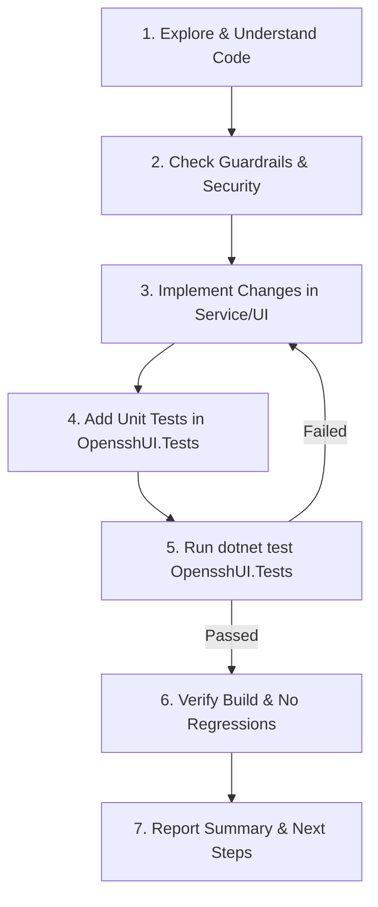

# AGENT.md - OpensshUI Development & Maintenance Guide

คู่มือมาตรฐานและแนวปฏิบัติที่ดีที่สุด (Best Practice & Operational Guide) สำหรับ AI Agent และนักพัฒนาในการบำรุงรักษา, พัฒนาต่อยอด และทดสอบระบบ **OpensshUI**

---

## 1. Executive Summary & Project Overview (ภาพรวมโครงการ)

**OpensshUI** เป็นเว็บแอปพลิเคชันที่พัฒนาด้วย **ASP.NET Core (.NET 8)** และ **Blazor Interactive Server** สำหรับบริหารจัดการ Windows OpenSSH SFTP Server บนระบบปฏิบัติการ Windows โดยเฉพาะ

### Core Responsibilities (ขอบเขตหน้าที่หลัก)
1. **User Management:** จัดการ Local Windows Users, การกำหนด Home Directory, Chroot Directory, Quota, และสถานะการเปิด/ปิดบัญชี
2. **SSH Key Management:** จัดการ Public Keys สำหรับ SFTP Authentication พร้อมตัวแปลงรูปแบบคีย์ (OpenSSH, RFC4716, PKCS#8/PEM, PuTTY .ppk)
3. **Group & Junction Management:** จัดการ SFTP Groups และสร้าง NTFS Directory Junctions สำหรับการแชร์โฟลเดอร์ระหว่างกลุ่มผู้ใช้
4. **NTFS ACL Provisioning:** กำหนดสิทธิ์โฟลเดอร์ระดับ OS (SYSTEM / Administrators Full Control, User Modify/Read-Only ตาม chroot spec)
5. **Secure File Browser:** ระบบสำรวจไฟล์ผ่านเว็บอินเทอร์เฟซ โดยจำกัดขอบเขตภายใต้ SFTP Root ป้องกัน Path Traversal
6. **OpenSSH Service Controller:** ควบคุมและตรวจสอบสถานะของ Windows Service (`sshd`)
7. **Authentication & Audit:** รองรับ LDAP / Active Directory ร่วมกับ Fallback Local Admin และบันทึก Audit Logs ทุกกิจกรรม

---

## 2. Architecture & Design Principles (สถาปัตยกรรมและหลักการออกแบบ)

โปรเจกต์นี้ใช้รูปแบบ **Hybrid Monolith (Clean Service Layer)** เพื่อความคล่องตัว ดูแลรักษาง่าย และไม่มีความซับซ้อนเกินจำเป็นของ Microservices หรือ Multi-project ที่แยกย่อยเกินไป

```
OpensshUI (Root Project - net8.0-windows)
├── Components/             # Blazor Interactive Server UI
│   ├── Layout/             # MainLayout, NavMenu, Scoped CSS
│   ├── Pages/              # Page components (Users, Groups, Files, Logs, Service, Settings)
│   └── Shared/             # Reusable UI widgets & Modals (e.g. FolderPickerModal)
├── Data/                   # EF Core DbContext & Migrations
│   └── AppDbContext.cs     # SQLite DbContext with Custom Migrations
├── Models/                 # Domain Entities & View Models (POCOs)
│   ├── AuditLog.cs
│   ├── LdapConfig.cs
│   ├── OpenSshLogEntry.cs  # Windows Event Log Models & Query Results
│   ├── SftpGroup.cs
│   ├── SftpUser.cs
│   ├── SshLogFilter.cs     # Time Presets & Filter Parameters
│   └── SshPublicKey.cs
├── Services/               # Core Business Logic & OS Integrations
│   ├── Audit/              # IAuditService, AuditService
│   ├── Auth/               # ILdapAuthService, LdapAuthService, UserSessionState
│   ├── Files/              # ISecureFileBrowserService, SecureFileBrowserService
│   ├── Groups/             # ISftpGroupService, SftpGroupService
│   ├── OpenSsh/            # WindowsUserManager, NativeAclProvisioner, OpenSshServiceManager, SshKeyConverter, OpenSshLogService, SshLogParser
│   ├── Security/           # IProtectionService, ProtectionService, PasswordHasher
│   └── Users/              # ISftpUserService, SftpUserService
└── OpensshUI.Tests/        # Test Suite (xUnit)
```

### Architectural Rules for Agents:
1. **Interface Segregation:** ทุก Service ในโฟลเดอร์ `Services/` ต้องมี Interface กำกับเสมอ (เช่น `ISftpUserService`) และลงทะเบียนใน DI Container ผ่าน `Program.cs`
2. **UI Decoupling:** ห้าม Razor Components เรียกใช้ OS APIs, `System.IO` (เช่น `Path.GetFullPath`, `Path.Combine`), Process Execution หรือ Entity Framework DbContext โดยตรง ต้องเรียกผ่าน Service Layer เสมอ
3. **DbContext Concurrency in Blazor:** Blazor Server มี Long-lived connection ห้าม Inject `AppDbContext` เป็น Scoped โดยตรง แต่ต้องใช้ `IDbContextFactory<AppDbContext>` เพื่อหลีกเลี่ยง Concurrency Issue และ Thread Safety Conflicts

### UI/UX & Blazor Component Standards (มาตรฐานการออกแบบ UI สำหรับผู้ดูแลระบบ):
1. **Unified Visual Hierarchy (ลำดับการไล่สายตามาตรฐานเดียวกันทุกหน้า):**
   - ทุกหน้าใน `Components/Pages/` ต้องเริ่มต้นด้วย `.page-header` (ซ้าย: `<h3 class="page-title">` พร้อมไอคอนประจำหน้าและคำอธิบายย่อย / ขวา: ปุ่มรอง `รีเฟรช` ตามด้วยปุ่ม Primary Action)
   - ถัดจาก Header เป็น Alert Banner -> Search & Filter Bar (พร้อมปุ่ม `ล้าง` เมื่อมีตัวกรองและตัวนับจำนวนรายการ) -> Data Card / Table
2. **Strict Icon-Text Alignment & Zero Redundant Emojis:**
   - ใช้ Bootstrap Icons (`<i class="bi ..."></i>`) เท่านั้น **ห้ามใช้ Emoji หรืออักขระพิเศษที่ซ้ำซ้อนกับ Icon**
   - ไอคอนทุกจุดต้องอยู่ในระดับกึ่งกลางแนวตั้งเดียวกับตัวหนังสือ (`display: inline-flex; align-items: center; line-height: 1;`) ตามคลาสใน `wwwroot/app.css`
3. **Ergonomic Admin Action Buttons:**
   - ในคอลัมน์ `การจัดการ (ACTIONS)` ของตาราง ให้ใช้ `.action-bar` โดยใส่ข้อความกำกับสั้นๆ คู่กับไอคอนในปุ่มหลัก (เช่น `แก้ไข`, `ไฟล์`, `ดาวน์โหลด`) และคั่นปุ่มอันตราย (`ลบ`, `Stop Service`) ออกไปทางขวาสุดด้วย `<span class="action-divider"></span>` เพื่อลดความเสี่ยงในการกดพลาด
4. **Consistent Language & Tone:**
   - ใช้ภาษาไทยควบคู่คำศัพท์เทคนิคมาตรฐาน (เช่น `จัดการกลุ่มผู้ใช้งาน SFTP (SFTP Groups)`) เหมือนกันทุกหน้าและทุก Modal (Header ของ Modal ใช้ `bg-dark text-white` หรือ `bg-danger text-white` สำหรับการยืนยันการลบ)

---

## 3. Security & OS Guardrails (ข้อกำหนดด้านความปลอดภัยขั้นสูง)

> [!CAUTION]
> โปรเจกต์นี้มีโค้ดที่สั่งการระบบปฏิบัติการ Windows (สร้าง User จริง, รัน net.exe, จัดการ ACLs, ควบคุม Service) การผิดพลาดอาจส่งผลกระทบต่อความมั่นคงปลอดภัยของเครื่อง Host

AI Agent **ต้องปฏิบัติตามกฎเหล็กเหล่านี้อย่างเคร่งครัด**:

### 3.1 Strict Process & Shell Execution Guardrails
- **ห้ามสร้าง Raw Shell Execution:** หลีกเลี่ยงการประกอบ String Command เช่น `cmd.exe /c "..."` หรือ `powershell -c "..."` ที่เสี่ยงต่อ Command Injection
- **ใช้ ProcessStartInfo แบบ Parameterized เท่านั้น:** ส่ง Arguments ผ่าน `ArgumentList` (เช่น `psi.ArgumentList.Add(...)`) แทนการต่อ String
- **Input Sanitization:** ตรวจสอบ Username, GroupName และ Path อย่างเข้มงวด ห้ามมีอักขระพิเศษที่เป็นอันตราย เช่น `;`, `&`, `|`, `` ` ``, `$`, `>`, `<`

### 3.2 Path Traversal & Filesystem Protection
- **Canonization Check:** ทุกคำสั่งที่เข้าถึง Path ต้องผ่านการ Normalization และตรวจสอบว่า Path ปลายทางอยู่ภายใต้ Root ที่กำหนดเสมอ เช่น:
  ```csharp
  var fullPath = Path.GetFullPath(requestedPath);
  if (!fullPath.StartsWith(allowedRoot, StringComparison.OrdinalIgnoreCase))
  {
      throw new UnauthorizedAccessException("Path traversal detected.");
  }
  ```
- **ห้ามแก้ไขไฟล์ระบบ:** ห้ามเขียนหรือลบไฟล์นอกเหนือจากไดเรกทอรี `app_data/`, SFTP Root (`C:\SFTPRoot`) และ OpenSSH Config Directory ที่กำหนดไว้ใน Configuration

### 3.3 Sensitive Data & Secrets Protection
- **No Plaintext Passwords:** ห้ามเก็บรหัสผ่านเป็น Plaintext ใน SQLite หรือ Log
- **ASP.NET DataProtection:** รหัสผ่าน LDAP Bind Password หรือ Credentials ใดๆ ต้องเข้ารหัสผ่าน `IProtectionService` (DataProtection API)
- **Local Fallback Admin:** ใช้ Secure Hash (เช่น PBKDF2 / SHA256 with Salt) ตามคลาส `PasswordHasher`

---

## 4. Testing & Verification Standards (มาตรฐานการทดสอบ)

### 4.1 Tooling
- **Test Framework:** `xUnit`
- **Mocking Library:** `NSubstitute` (หรือ `Moq`) สำหรับการ Mock Interfaces
- **Assertions:** `FluentAssertions` เพื่อความชัดเจนและอ่านง่ายของ Assertions
- **Database Testing:** ใช้ SQLite In-Memory หรือ Mock `IDbContextFactory<AppDbContext>`

### 4.2 Rules for Testing
1. **Mock OS Dependencies:** ในการทดสอบ Unit Tests ห้ามเรียก `net.exe`, ห้ามสร้าง Windows User จริง, และห้ามเรียก Windows Service Controller บนเครื่องทดสอบ ต้องทำการ Mock ผ่าน Interface ของ Manager เสมอ
2. **Mandatory Test Execution:** ก่อนสรุปงานทุกครั้ง Agent ต้องรันชุดทดสอบและยืนยันว่าผลผ่าน 100%:
   ```powershell
   dotnet test OpensshUI.Tests\OpensshUI.Tests.csproj
   ```
3. **No Regressions:** ห้ามมี Test Case ใดที่ล้มเหลว (Failed: 0)

---

## 5. Development Workflow & Commands (คำสั่งและแนวทางการทำงาน)

### Build & Run
```powershell
# Restore & Build Project
dotnet build OpensshUI.csproj

# Run Tests
dotnet test OpensshUI.Tests\OpensshUI.Tests.csproj

# Run Web Application (Development)
dotnet run --project OpensshUI.csproj
```

### Note on Solution Structure:
- ปัจจุบันโปรเจกต์ `OpensshUI.Tests` ตั้งอยู่เป็น Subfolder ภายใน root ของ `OpensshUI` การรันคำสั่ง `dotnet build` หรือ `dotnet test` ควรกำหนด Path ไปยัง `.csproj` โดยตรงเพื่อป้องกัน MSBuild evaluation conflict

---

## 6. Technical Debt & Improvement Roadmap (รายการปรับปรุงและ Technical Debt)

Agent ที่เข้ามาดูแลงานต่อ สามารถอ้างอิงลำดับความสำคัญ (Priority) ในการปรับปรุงระบบได้ดังนี้:

### Priority 1: High (ความปลอดภัยและความพร้อมในการทดสอบ) [COMPLETED]
- [x] **Introduce Interfaces for OS Managers:**
  - สร้าง `IWindowsUserManager`, `INativeAclProvisioner`, `IOpenSshServiceManager`
  - ปรับ `SftpUserService` และ `SftpGroupService` ให้รับ Interfaces เหล่านี้ เพื่อให้สามารถเขียน Unit Test ได้ครบ 100% โดยไม่ต้องแตะ OS จริง
- [x] **Refactor `net.exe` execution to `ArgumentList`:**
  - ปรับปรุงการเรียก `ProcessStartInfo` ใน `WindowsUserManager`, `NativeAclProvisioner` และ `OpenSshServiceManager` จากการต่อ String `Arguments` ให้ใช้ `ArgumentList.Add(...)` ป้องกัน Argument Injection โดยสมบูรณ์

### Priority 2: Medium (โครงสร้างและการจัดการข้อผิดพลาด)
- [ ] **Project Layout Normalization:**
  - ปรับโครงสร้าง Root ให้เป็นระเบียบตามมาตรฐาน .NET Standard:
    ```
    root/
    ├── OpensshUI.sln
    ├── src/
    │   └── OpensshUI/
    └── tests/
        └── OpensshUI.Tests/
    ```
    *(หมายเหตุ: เมื่อแยกโฟลเดอร์ `src/` และ `tests/` แล้ว จะสามารถใช้ `OpensshUI.sln` ได้อย่างสมบูรณ์แบบโดยไม่มี Path collision)*
- [ ] **Unified Result Pattern:**
  - นำ `Result<T>` หรือ `OperationResult` มาใช้แทนการ Return `bool` ใน Service Layer เพื่อส่งต่อ Error Messages ที่ชัดเจนไปยัง UI

### Priority 3: Low (ฟีเจอร์และการปรับปรุงทั่วไป)
- [ ] **EF Core Migrations:**
  - เปลี่ยนจากการใช้ `db.Database.EnsureCreated()` และ Custom SQL Scripts มาใช้ Code-First EF Core Migrations มาตรฐาน (`dotnet ef migrations add`)
- [ ] **Comprehensive bUnit Testing:**
  - ติดตั้ง `bUnit` สำหรับทดสอบ Blazor Component Rendering และ Event Handling

---

## 7. AI Agent Execution Playbook (คู่มือการทำงานทีละขั้นตอนสำหรับ AI)

เมื่อได้รับมอบหมายให้แก้ไขบั๊กหรือเพิ่มฟีเจอร์ ให้ปฏิบัติตามลำดับขั้นนี้เสมอ:



1. **สำรวจโค้ด (Explore):** อ่านไฟล์ที่เกี่ยวข้อง ตรวจสอบการพึ่งพา (Dependencies) ใน `Program.cs`
2. **ตรวจสอบความปลอดภัย (Security Check):** ตรวจสอบว่าไม่มี Hardcoded Secret, มีการ Sanitize Input, และใช้ Parameterized Arguments
3. **เขียนโค้ด (Implement):** พัฒนาตามหลัก Single Responsibility และ Hybrid Monolith
4. **เขียนและรันชุดทดสอบ (Test):** เขียน Unit Test ครอบคลุม Business Logic ใหม่ และรัน `dotnet test OpensshUI.Tests\OpensshUI.Tests.csproj`
5. **ตรวจสอบความเรียบร้อย (Verify):** ยืนยันว่าโค้ดคอมไพล์ผ่าน ไม่เกิด Warning สำคัญ และเทสผ่านครบ 100%
